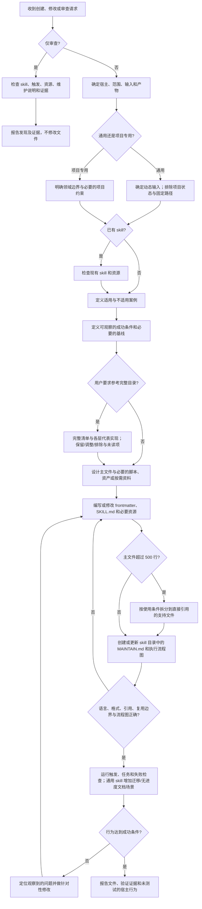

# best-creating-skills — 维护说明

本文供人类维护者阅读。代理需要执行的规则集中写在 `SKILL.md` 中；修改本 skill 时同步核对下列文件。

## 用途与边界

- **用途：** 创建、修改和审查可移植的 Agent Skills，涵盖选题、元数据、触发、内容分层、顺序关口、脚本接口、安全、跨宿主验证、行为评测、故障定位及维护。
- **触发：** 用户要求创建或改进 `SKILL.md` skill，或审查其触发、流程、引用、测试和维护说明。
- **不触发：** 普通 prompt 编写、一般仓库指令，或安装一个不需要修改的第三方 skill。
- **产物：** 创建／修改任务交付含 `SKILL.md`、必要资源和 `MAINTAIN.md` 的 skill 目录；纯审查任务交付问题及修改建议，不擅自改文件。
- **用户约定：** 每个被创建或修改的 skill 都要有自己的 `MAINTAIN.md` 和准确的执行流程图。这不是 Agent Skills 开放规范的要求。
- **语言与复用范围：** 默认中文 description、正文与维护说明，技术名保留原文；用户/受众要求优先，这是本地约定。先区分通用与项目专用；通用 skill 不绑定项目进度、私有路径或当前实施状态。

## 执行流程图

流程图对应 `SKILL.md` 的七阶段流程。小范围修改可略过无关的设计阶段，但仍需编写或更新维护说明、验证并报告。纯审查只报告，不修改文件。

## 文件作用

| 文件 | 作用 | 维护要求 |
| --- | --- | --- |
| `SKILL.md` | 触发条件、七阶段流程、十三组具体规则、故障定位和交付核对项 | 保持自足；超过 500 行时按条件拆分；规则或宿主行为变化时同步修改。 |
| `MAINTAIN.md` | 人类维护说明和真实流程图 | 阶段、分支、验证或产物变化时同步更新。 |
| `agents/openai.yaml` | Codex 展示信息 | 名称和短描述应与 skill 一致。 |

## 验证与已知限制

- 目标宿主有校验器时先检查格式；另需人工核对资源路径、流程图和真实执行行为。语法通过不等于 skill 有效。
- 修改主流程时至少测试典型创建任务、相近的不适用请求和失败／验证路径；较大改动与旧版比较。
- 外部平台规则会变化。依赖权限、安装目录、API 或模型触发行为前，重新检查官方文档。
- 编号步骤不能保证代理一定依序执行；严格的机械关口应在需要时由被创建 skill 的脚本或校验器保证。
- 语言/项目耦合/来源覆盖的结构检查不能替代真实任务验证；格式正确或手动加载成功不能证明隐式选择稳定。
- 本轮三个新增结构关口先复现缺失，再修改后通过；独立只读方案试跑验证了通用状态隔离、完整来源的受限覆盖报告、明确英文要求优先及纯审查不改文件。该试跑不证明所有宿主或全部创建任务均通过。

## 变更记录

- 2026-10-11：补充中文默认与例外、通用/项目专用分界、完整目录来源覆盖、保留/调整/排除和迁移验收；同步流程图。验证结果据实际执行更新，不推定所有宿主行为。
- 2026-09-28：根据 `/Users/burt/Desktop/个人/学习文档/Agent-Skills-编写最佳实践研究.md` 创建。无本 skill 的对照案例漏了维护文件；独立使用测试创建了维护文件与流程图。随后明确了纯审查不修改文件的分支。
- 2026-09-28：扩充中文操作规则，并在当时使用独立文件保存来源链接。
- 2026-09-28：按用户要求将规则集中到 `SKILL.md`，删除来源链接文件，补充顺序执行示例和交付核对项。
- 2026-09-28：对照研究资料补充具体规则和故障定位；明确主文件超过 500 行时再拆分，不为控制篇幅删减必要规则。
